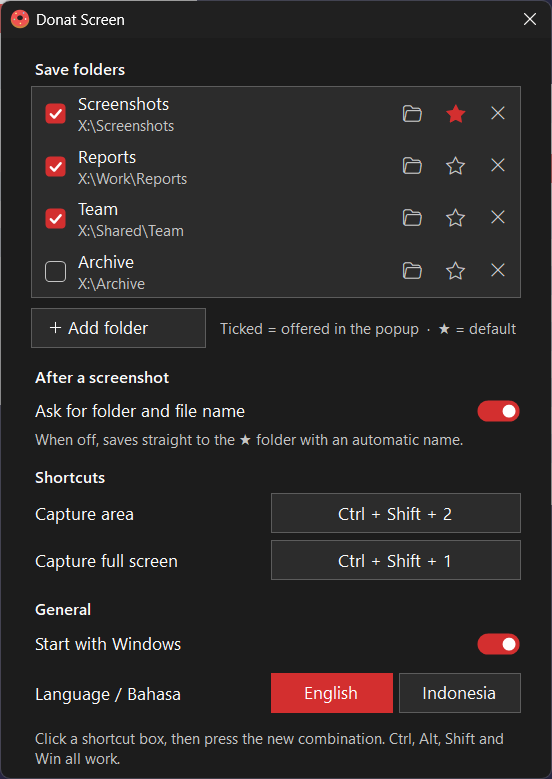
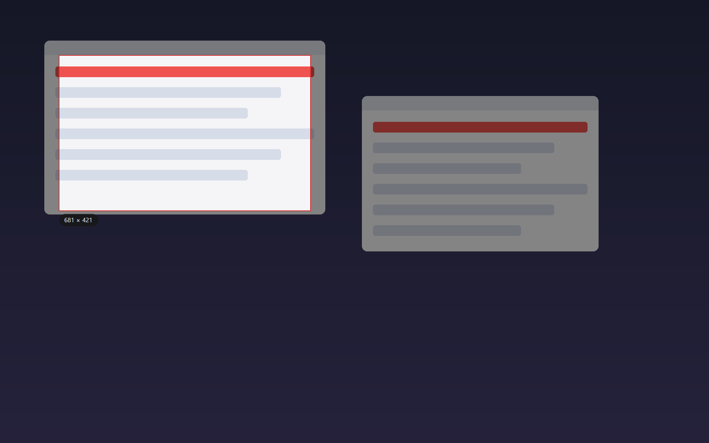
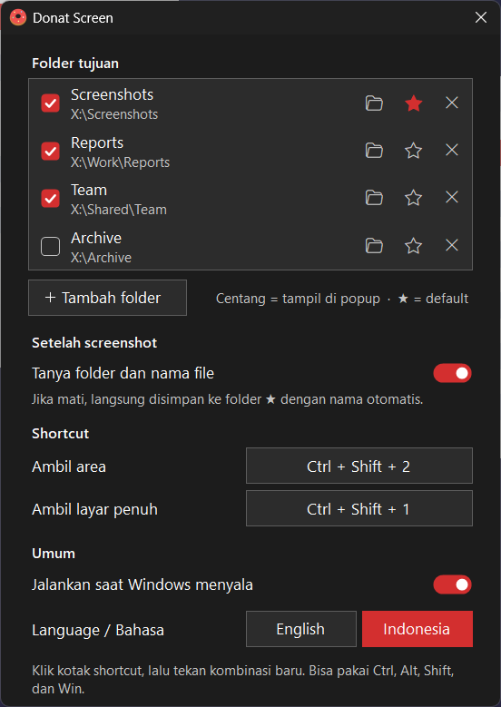

<p align="center">
  
</p>

<h1 align="center">Donat Screen</h1>

<p align="center">
  A tiny, portable screenshot tool for Windows that lives in the tray.<br>
  Press a hotkey, pick an area, and the shot is on your clipboard and saved where you want it.
</p>

<p align="center">
  <a href="../../releases/latest"><b>Download the latest release</b></a> ·
  one ~100 KB <code>.exe</code>, nothing to install · Windows 10/11
</p>



## Features

| Feature | Details |
| --- | --- |
| **Two hotkeys** | <kbd>Ctrl</kbd>+<kbd>Shift</kbd>+<kbd>2</kbd> captures an area, <kbd>Ctrl</kbd>+<kbd>Shift</kbd>+<kbd>1</kbd> the full screen of every monitor. Both can be changed, including combinations with <kbd>Win</kbd>. |
| **Area picker** | The screen freezes and dims; drag to select (the size is shown), click to take one whole monitor, <kbd>Esc</kbd> or right-click to cancel. |
| **Clipboard first** | Every shot goes to the clipboard before anything else: as a bitmap for Office and chat apps, and as PNG for browsers. |
| **Save popup** | A preview, a file name to edit, and the save folders to tick, one or several. <kbd>Enter</kbd> saves, <kbd>Esc</kbd> saves to the default ★ folder with an automatic name. It can be turned off to save straight away. |
| **Never overwrites** | A name that exists gets a number: `report.png` → `report (2).png`. |
| **Save folders** | Keep a list of folders, star the default, choose which ones the popup offers, and change a path by clicking it. Folders inside the app folder are stored relative to it, so a USB stick works under any drive letter. |
| **Safe shortcuts** | When you record a shortcut, the app refuses ones that Windows already uses (<kbd>Win</kbd>+<kbd>Shift</kbd>+<kbd>S</kbd>, …), ones another app holds, and single-modifier combinations that clash with app shortcuts. |
| **Captures everything** | Layered windows such as tooltips and open menus are included. Works across monitors with different scaling. |
| **Portable** | One exe; settings are kept in `DonatScreen.ini` next to it. .NET Framework 4.8 is already part of Windows 10/11. |
| **Tray app** | Optional start with Windows (quietly, straight to the tray). Launching it again opens Settings. |
| **Look** | Follows the Windows light/dark theme. English or Bahasa Indonesia, switched live in Settings. |

## Screenshots

| Area picker | Save popup |
| --- | --- |
|  |  |

<details>
<summary>Bahasa Indonesia</summary>



</details>

## Usage

1. Download `DonatScreen.exe` from [Releases](../../releases/latest) and put it in any folder (or on a USB stick). Run it.
2. On the first run Settings opens. Pick your save folders and shortcuts; the app then waits in the tray.
3. Press <kbd>Ctrl</kbd>+<kbd>Shift</kbd>+<kbd>2</kbd> and drag over an area, or <kbd>Ctrl</kbd>+<kbd>Shift</kbd>+<kbd>1</kbd> for the full screen. Paste it anywhere, or pick where to save it.

Left-click the tray icon for Settings; right-click it for the capture commands, the default folder and **Quit**. Click the notification after a save to show the file in Explorer.

Windows SmartScreen may warn about an unknown publisher on the first launch, because the exe isn't code-signed. Choose **More info → Run anyway**.

**Known limit:** exclusive full-screen DirectX games can come out black, since the capture uses the regular desktop (GDI).

## Build from source

You need the [.NET SDK](https://dotnet.microsoft.com/download) on Windows (tested with .NET 10; the app targets .NET Framework 4.8). There are no NuGet dependencies.

```powershell
dotnet build -c Release -o build    # -> build\DonatScreen.exe
.\test.ps1                          # end-to-end test on the real exe
```

`test.ps1` first checks that every UI text has an English translation. It then runs the real exe and presses the hotkeys, drags the mouse, records shortcuts, and pastes into Word and Edge. It takes over the keyboard and mouse for about a minute, and only sends input while a Donat Screen window is in front. The Edge paste needs Python with [Playwright](https://playwright.dev/python/); the Word paste is skipped when Word isn't installed.

## License

[MIT](LICENSE) © 2026 Dani Abdani
