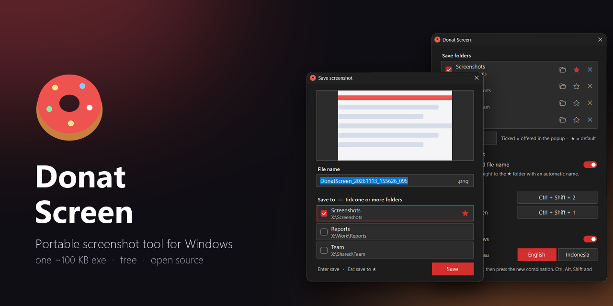
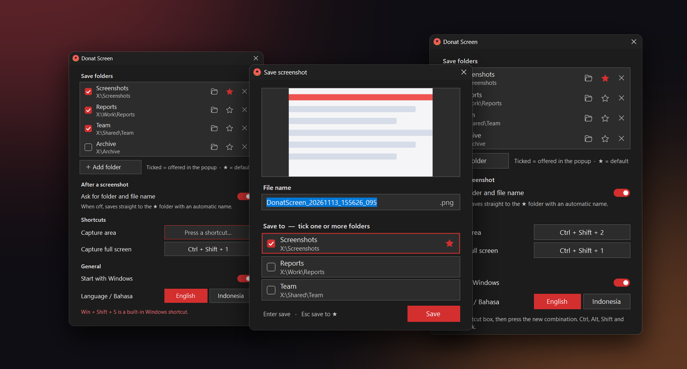
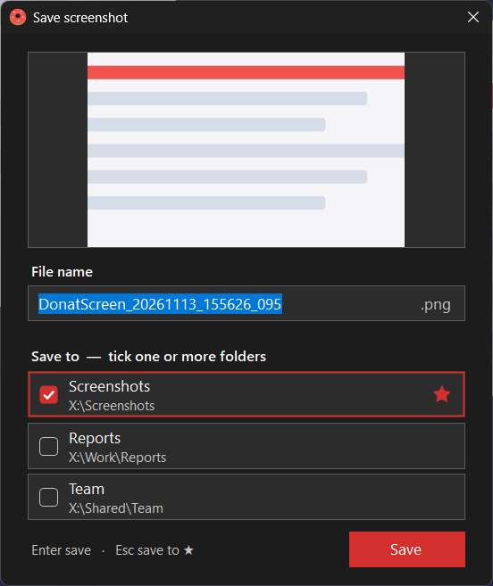
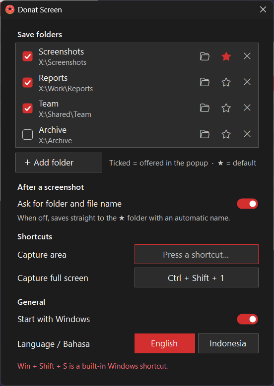
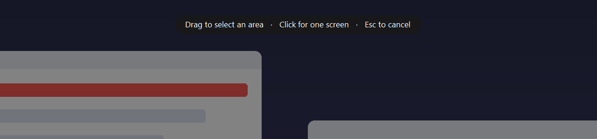

<p align="center">
  <a href="https://abdani.github.io/Donat-Screen/"></a>
</p>

<h1 align="center">Donat Screen</h1>

<p align="center">
  A tiny Windows screenshot tool with fully customizable save folders.<br>
  <b>Snap. Pick a folder. Done.</b><br>
  <sub>In a hurry? Press <kbd>Esc</kbd> to save to your default folder.</sub>
</p>

<p align="center">
  
  
  
  
</p>

<p align="center">
  <a href="https://abdani.github.io/Donat-Screen/"><b>🌐 Homepage</b></a> ·
  <a href="../../releases/latest/download/DonatScreen.exe"><b>⬇ Download DonatScreen.exe</b></a> ·
  nothing to install · no internet, no telemetry
</p>



## Features

| Feature | Details |
| --- | --- |
| **Two hotkeys** | <kbd>Ctrl</kbd>+<kbd>Shift</kbd>+<kbd>2</kbd> captures an area, <kbd>Ctrl</kbd>+<kbd>Shift</kbd>+<kbd>1</kbd> the full screen of every monitor. Both can be changed, including combinations with <kbd>Win</kbd>. |
| **Area picker** | The screen freezes and dims; drag to select (the size is shown), click to take one whole monitor, <kbd>Esc</kbd> or right-click to cancel. |
| **Clipboard first** | Every shot goes to the clipboard before anything else: as a bitmap for Office and chat apps, and as PNG for browsers. |
| **Save popup** | A preview, a file name to edit, and the save folders to tick, one or several. <kbd>Enter</kbd> saves, <kbd>Esc</kbd> saves to the default ★ folder with an automatic name. It can be turned off to save straight away. |
| **Never overwrites** | A name that exists gets a number: `report.png` → `report (2).png`. |
| **Save folders** | Keep a list of folders, star the default, choose which ones the popup offers, and change a path by clicking it. Folders inside the app folder are stored relative to it, so a USB stick works under any drive letter. |
| **Safe shortcuts** | When you record a shortcut, the app refuses ones that Windows already uses (<kbd>Win</kbd>+<kbd>Shift</kbd>+<kbd>S</kbd>, …), ones another app holds, and single-modifier combinations that clash with app shortcuts. |
| **Captures everything** | Layered windows such as tooltips and open menus are included. Works across monitors with different scaling. |
| **Portable** | One exe; settings are kept in `DonatScreen.ini` next to it. .NET Framework 4.8 is already part of Windows 10/11. |
| **Tray app** | Optional start with Windows (quietly, straight to the tray). Launching it again opens Settings. |
| **Look** | Follows the Windows light/dark theme. English or Bahasa Indonesia, switched live in Settings. |

## Screenshots

| Save popup | Recording a shortcut: Windows' own ones are refused |
| --- | --- |
|  |  |

When the area picker opens, the screen dims and this hint shows at the top:



<details>
<summary>Bahasa Indonesia</summary>


</details>

## Features in detail

<details>
<summary><b>Show all details</b> — capturing, saving, folders, shortcuts, tray, settings file, privacy</summary>

### Capturing
- **Area** (<kbd>Ctrl</kbd>+<kbd>Shift</kbd>+<kbd>2</kbd>): the whole desktop is frozen the moment you press the hotkey, so open menus and tooltips stay as they were. Drag to select; the size in pixels follows the selection. A click without dragging takes the monitor under the cursor. <kbd>Esc</kbd> or a right-click cancels.
- **Full screen** (<kbd>Ctrl</kbd>+<kbd>Shift</kbd>+<kbd>1</kbd>): all monitors in one image.
- Shots are lossless PNG files named `DonatScreen_YYYYMMDD_HHMMSS_mmm.png`.

### After the capture
- The image is on the **clipboard** right away, before any question: as a bitmap (Word, Excel, PowerPoint, Paint, chat apps) and as PNG (browsers, Google Docs, GIMP).
- The **save popup** opens on the monitor you're working on: preview, file name (`.png` is added for you), and the folders to tick. <kbd>Enter</kbd> saves to every ticked folder; <kbd>Esc</kbd> or closing it saves to the ★ folder with the automatic name. Names that Windows can't store (`a:b`, `CON`, …) are refused with a message.
- Turn off **Ask for folder and file name** to skip the popup and save straight to the ★ folder.
- A **notification** says where the file went; click it to show the file in Explorer. If the clipboard is busy in another app, or a folder can't be written, the notification says so and the other copies are still saved.

### Save folders
- The list holds as many folders as you like (it scrolls after five). The ★ marks the default, which is always offered; the check box decides whether a folder appears in the popup.
- Per folder: open it, make it the default, or remove it from the list (its files are never touched). Click the path line to type or paste a new location: <kbd>Enter</kbd> applies, <kbd>Esc</kbd> reverts, and a missing or duplicate folder is refused.
- The first run starts with `Pictures\Donat Screen`. Folders inside the app's own folder are stored relative to it, so the whole thing can live on a USB stick.

### Shortcuts
- Click a shortcut box and press the new combination; <kbd>Esc</kbd> stops recording. While you record, both hotkeys are paused and every key is swallowed, so <kbd>Win</kbd> combinations don't fire.
- A combination is refused when it is:
  - a Windows shortcut (<kbd>Win</kbd>+<kbd>Shift</kbd>+<kbd>S</kbd>, <kbd>Win</kbd>+digits or arrows, <kbd>Alt</kbd>+<kbd>PrtSc</kbd>, …) or <kbd>Win</kbd> plus a single key;
  - fewer than two of <kbd>Ctrl</kbd>/<kbd>Alt</kbd>/<kbd>Shift</kbd> without <kbd>Win</kbd> (these clash with app shortcuts), except <kbd>F13</kbd>–<kbd>F24</kbd>, <kbd>PrtSc</kbd>, <kbd>Pause</kbd> and <kbd>Scroll Lock</kbd>;
  - <kbd>PrtSc</kbd> while Windows gives that key to the Snipping Tool (the message tells you where to turn that off);
  - already held by another app, or used for the other capture.
- If a saved hotkey is taken by another app at startup, a notification says which one; the other hotkey keeps working.

### Tray and startup
- Left-click the tray icon for Settings. Right-click for **Capture area**, **Capture full screen**, **Open default folder**, **Settings** and **Quit**.
- Only one copy runs; starting it again opens its Settings.
- **Start with Windows** adds a per-user entry (no admin rights) that starts quietly in the tray. If you move the exe, the entry follows it on the next start.

### Settings file
Everything is kept in `DonatScreen.ini` next to the exe:

```ini
Dest=1|Screenshots
Dest=0|D:\Work\Reports
Default=0
Ask=1
RegionKey=D2, Shift, Control
FullKey=D1, Shift, Control
Lang=en
```

- `Dest=<1 or 0>|<folder>`: one line per save folder. `1` means it is offered in the popup. The folder is relative to the exe, or absolute.
- `Default`: which `Dest` line is the ★ folder, counting from 0.
- `Ask`: `1` shows the save popup, `0` saves straight away.
- `RegionKey` / `FullKey`: the hotkeys; a `Win` combination gets an extra `, Win`.
- `Lang`: `en` or `id`.

The ini has no comment syntax; Settings writes it for you, so editing it by hand is rarely needed.

### Privacy
Donat Screen never connects to the internet: no updates, no telemetry. Screenshots only go to the clipboard and the folders you choose.

</details>

## Usage

1. Download `DonatScreen.exe` from [Releases](../../releases/latest) and put it in any folder (or on a USB stick). Run it.
2. On the first run Settings opens. Pick your save folders and shortcuts; the app then waits in the tray.
3. Press <kbd>Ctrl</kbd>+<kbd>Shift</kbd>+<kbd>2</kbd> and drag over an area, or <kbd>Ctrl</kbd>+<kbd>Shift</kbd>+<kbd>1</kbd> for the full screen. Paste it anywhere, or pick where to save it.

Left-click the tray icon for Settings; right-click it for the capture commands, the default folder and **Quit**. Click the notification after a save to show the file in Explorer.

⚠️ Windows SmartScreen may warn about an unknown publisher on the first launch, because the exe isn't code-signed. Choose **More info → Run anyway**.

**Known limit:** exclusive full-screen DirectX games can come out black, since the capture uses the regular desktop (GDI).

## Build from source

You need the [.NET SDK](https://dotnet.microsoft.com/download) on Windows (tested with .NET 10; the app targets .NET Framework 4.8). There are no NuGet dependencies.

```powershell
dotnet build -c Release -o build    # -> build\DonatScreen.exe
.\test.ps1                          # end-to-end test on the real exe
```

`test.ps1` first checks that every UI text has an English translation. It then runs the real exe and presses the hotkeys, drags the mouse, records shortcuts, and pastes into Word and Edge. It takes over the keyboard and mouse for about a minute, and only sends input while a Donat Screen window is in front. The Edge paste needs Python with [Playwright](https://playwright.dev/python/); the Word paste is skipped when Word isn't installed.

## License

[MIT](LICENSE) © 2026 Dani Abdani
